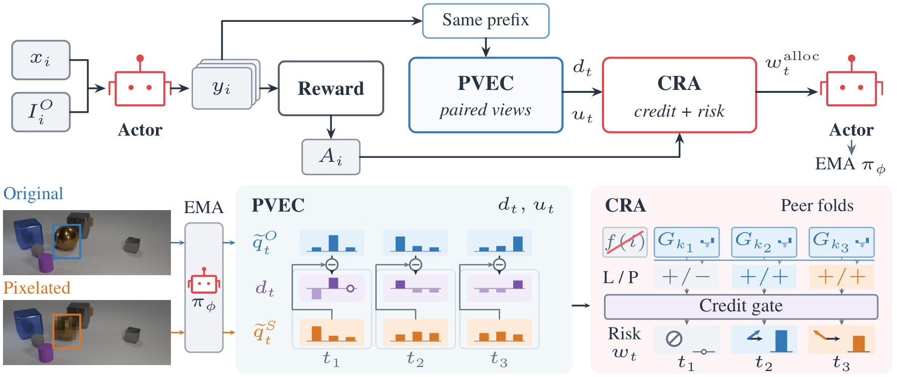
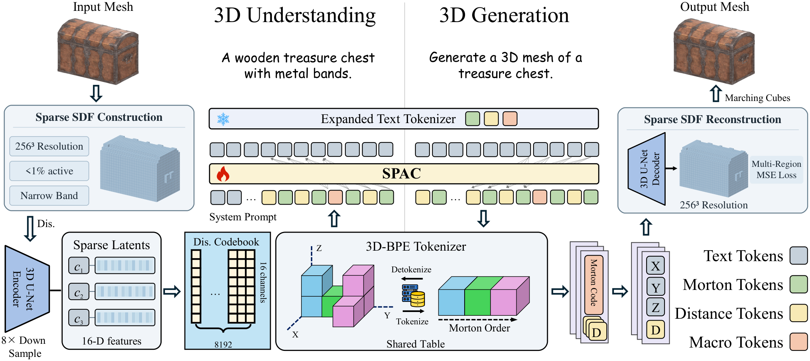
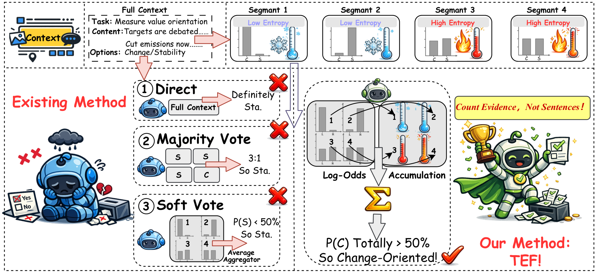
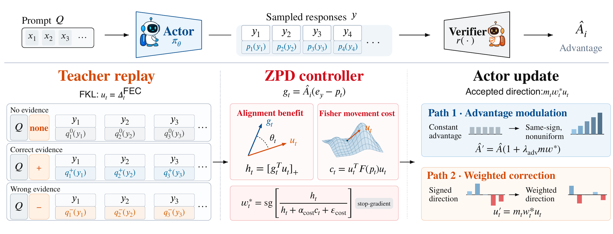
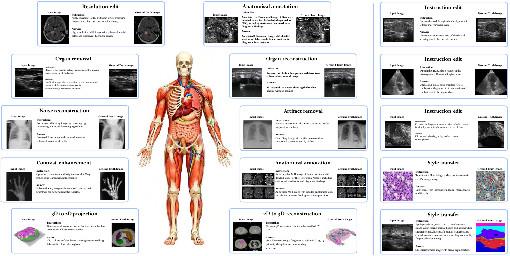

I am **Junjie Yang**, currently pursuing a master’s degree in Applied Machine Learning at the University of Maryland, College Park. I earned my bachelor’s degree in Computer Science and Engineering from South China University of Technology (SCUT), where I studied in the English-Taught Innovation Class. My academic work has included collaborations with [Weiwei Lin](https://www.scholat.com/linweiwei), [Changmiao Wang](https://jiandanjinxin.github.io/changmiaowang/), and [Yao Wan](http://wanyao.me/).

My research interests include computer vision, medical AI, 3D vision, and agentic reinforcement learning.

# Selected Projects

RAVEC

### [RAVEC: Reward-Aligned Visual Evidence Correction](/ravec/)

RAVEC uses paired views of visual evidence to propose token-level corrections for reinforcement learning. It checks the local and cross-question reward support for each correction before allocating a shared response budget.

[**Open project page**](/ravec/)

SPAC

### [From Dense to Sparse: Morton-Ordered Sparse Mapping for Efficient 3D Mesh Generation](/spac/)

SPAC combines near-surface geometry tokens, spatial 3D byte-pair encoding, and Morton ordering in one autoregressive model for mesh understanding and generation.

[**Open project page**](/spac/)

TEF

### [TEF: Count Evidence, Not Sentences](https://github.com/Kzczc/ICASSP2027-TEF)

Tempered Evidence Fusion (TEF) is a **training-free method for measuring value orientations in long text**. It gives more weight to decisive sentence-level LLM judgments and discounts uncertain ones. The work also introduces MIND, a benchmark of 8,358 Chinese and English posts across six value dimensions.

[**Paper**](https://arxiv.org/abs/2609.27165) · [**Code**](https://github.com/Kzczc/ICASSP2027-TEF)

VERPO

### [VERPO: Verified Evidence Regularized Policy Optimization](https://github.com/hamsterjiang23/VERPO)

VERPO turns evidence-conditioned guidance into **reward-aligned token-level credit assignment** for reinforcement learning. Its Fisher-aware controller and Fisher Evidence Contrast help stabilize optimization while retaining outcome-level rewards.

[**Paper**](https://arxiv.org/abs/2609.06100) · [**Code**](https://github.com/hamsterjiang23/VERPO)

MedGEN-Bench

### [MedGEN-Bench: A Contextually Entangled Benchmark](/medgen/)

MedGEN-Bench is a benchmark for open-ended multimodal medical generation. The reported evaluation snapshot contains **6,422 expert-reviewed image–text pairs** spanning six canonical imaging modalities, 15 clinical tasks, and 27 named subtasks, including visual question answering, image editing, and contextual multimodal generation.

[**Open project page**](/medgen/) · [**Paper**](https://arxiv.org/abs/2511.13135) · [**Dataset**](https://huggingface.co/datasets/Jack04810/MedGEN-Bench)

# Publications

- **Count Evidence, Not Sentences: Tempered Evidence Fusion of LLM Judgments for Long-Text Value Measurement**, Yuhe Wu, Rui Qian, Guangyu Wang, Yuran Chen, Yuanchao Zhu, **Junjie Yang**, et al. [**arXiv**](https://arxiv.org/abs/2609.27165) · [**Code**](https://github.com/Kzczc/ICASSP2027-TEF)

- **VERPO: Verified Evidence Regularized Policy Optimization**, Haijiang Li, Chengyu Lv, Yi Zhang, Rui Qian, Zhibing Zhang, Xiangqing Shen, **Junjie Yang**, et al. [**arXiv**](https://arxiv.org/abs/2609.06100) · [**Code**](https://github.com/hamsterjiang23/VERPO)

- **MedGEN-Bench: Contextually entangled benchmark for open-ended multimodal medical generation**, Junjie Yang, Yuhao Yan, Rui Qian, et al. [**arXiv**](https://arxiv.org/abs/2511.13135) · [**Project page**](/medgen/)

# News

- *2026*: MedGEN-Bench open source at [**Project page**](/medgen/)!
